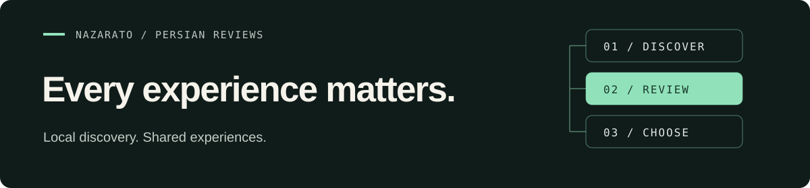

# نظراتو · Nazarato

A Persian review and discovery platform for Iranian businesses and Instagram shops. Nazarato brings business profiles, local discovery, and moderated reviews into an interface designed for right-to-left reading.

**[Website](https://nazarato.ir)** · **[Architecture](docs/PROJECT.md)** · **[Release readiness](docs/production-readiness.md)**

> **Current stage:** an early public introduction. The homepage is the only page enabled for indexing. Production sign-in remains closed while real SMS delivery and per-challenge verification are completed; the repository contains the developing product beyond that public introduction.

## Product and implementation

- **Local discovery:** area selection, business search, categories, and company/shop profiles. Public results require approved source provenance and an eligible business status.
- **Review workflows:** a shared review sheet, moderation states, helpful votes, and account-area interfaces. Real public review intake depends on reopening verified sign-in.
- **Business operations:** ownership-claim, owner-dashboard, and moderation modules.
- **Persian experience:** RTL layouts, Vazirmatn typography, Persian numbers, and an installable PWA shell.
- **Content:** repository-backed blog articles, with an optional WordPress integration.
- **Integrations:** Web Push infrastructure and an optional Gemini chat endpoint. Their availability depends on configuration and product readiness.

Voice input has been retired; the former transcription endpoint returns `410 Gone`.

## Stack

| Layer | Technology |
| --- | --- |
| Application | Next.js 16 App Router, React 19, TypeScript |
| Interface | Tailwind CSS 4, RTL Persian layouts |
| Data | Supabase PostgreSQL; server-side data access |
| Authentication | App-managed phone flow and signed cookie sessions |
| Hosting | Cloudflare Workers through OpenNext |
| Verification | Vitest, Playwright, ESLint |

Exact dependency versions live in [package.json](package.json) and the lockfile.

## Run locally

```bash
git clone https://github.com/sobhanashine/nazarato.git
cd nazarato
npm ci
```

Create `.env.local` in the repository root with the configuration below, then start the application:

```bash
npm run dev
```

Open [localhost:3000](http://localhost:3000). The development phone flow uses a fixed test code from [lib/auth/otp.ts](lib/auth/otp.ts); it does not send SMS. Production rejects this development flow.

### Configuration

| Variable | Purpose |
| --- | --- |
| `NEXT_PUBLIC_SUPABASE_URL` | Existing Supabase project URL |
| `SUPABASE_SERVICE_ROLE_KEY` | Server-only database access |
| `JWT_SECRET` | Signing key for app sessions |
| `NEXT_PUBLIC_SUPABASE_PUBLISHABLE_KEY` / `NEXT_PUBLIC_SUPABASE_ANON_KEY` | Public client configuration where required by the environment |
| `WP_API_URL` | Optional WordPress content source; local articles work without it |
| `GEMINI_API_KEY` | Optional AI chat; unconfigured requests return an unavailable-service response |
| `VAPID_PUBLIC_KEY`, `VAPID_PRIVATE_KEY`, `NEXT_PUBLIC_VAPID_PUBLIC_KEY`, `VAPID_SUBJECT` | Optional Web Push configuration |

Keep service-role, session, and provider secrets on the server. Production SMS is unfinished: adding provider credentials alone does not enable secure public sign-in. See the [readiness record](docs/production-readiness.md) for the remaining integration work.

## Commands

| Command | Purpose |
| --- | --- |
| `npm run dev` | Local Next.js development |
| `npm run lint` | ESLint |
| `npm test` | Vitest suite |
| `npm run test:e2e` | Playwright browser flows |
| `npm run build` | Next.js production build |
| `npm start` | Serve the Next.js build locally |
| `npm run build:cloudflare` | Build the OpenNext Worker output |
| `npm run preview:cloudflare` | Preview the built Worker locally |
| `npm run deploy:cloudflare` | Build and publish the configured Worker |

Install Playwright's browser with `npx playwright install chromium` before the first browser run.

## Repository map

```text
app/                    Public pages, account areas, route handlers
components/             Layout, discovery, reviews, business and admin UI
lib/auth/               Development phone flow and session helpers
lib/data/               Business, review, discovery and content access
lib/supabase/           Server-side Supabase client
lib/push/               Web Push delivery
supabase/migrations/    Versioned database schema
e2e/                    Browser scenarios
docs/                   Architecture, provenance and release records
```

## Data and release boundaries

The public catalog accepts approved sources; failed reads do not fall back to sample businesses. An ignored Golsar catalog is a loopback-only development preview and is not a public import. Sample reviews, preview records, and test counts must not be represented as real customer activity.

The existing `nazarato` Worker is connected to `main`. Apply database migrations to the intended existing environment, preserve runtime bindings, and follow the [Cloudflare release guide](docs/cloudflare-release.md). Use feature branches and the documented `dev` → `main` release path; do not commit directly to `main`.

Further reading: [data model](docs/data-model.md) · [public domain and SEO](docs/domain-seo-launch.md) · [local discovery](docs/local-discovery.md) · [contribution rules](AGENTS.md).

---

By [Sobhan Ashineh](https://github.com/sobhanashine) · [Full portfolio at FMS](https://futuremservices.ir/en/work)
