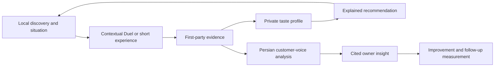

# Nazarato: product, design, and delivery audit

**Audit date:** 6 October 2026, Asia/Tehran. **Status:** report delivered for review; no implementation, merge, database change, or deployment.

**Verdict:** Your concern is supported by evidence. Nazarato's agreed product is only partially represented in the current release branch. Much of the missing work still exists in a separate branch. Some important user journeys remain unfinished even there. The immediate need is to reconcile those implementations and finish one complete product journey, rather than start another broad redesign or rebuild.

This does **not** establish that a particular AI forgot something. Git history shows a concrete integration gap; Trello and the documents show competing versions of the product context.

## 1. What was inspected

- Only `sobhanashine/nazarato`, its local checkouts, and the specified Trello board `eHnJFMki`.
- All **39 pre-existing Trello cards**, all **54 card comments**, all seven lists, and the checklist endpoint. There were no separate Trello checklist objects; acceptance criteria often live in descriptions.
- GitHub branches, open pull requests, 38 open issue summaries, release check results, and immutable source snapshots.
- Product specifications, route structure, consumer entry points, reviews, bookmarks, profiles, auth/Claim, provenance, migrations, intelligence, recommendations, owner workflows, and relevant tests.
- The uncommitted mobile redesign was inspected as work in progress, separately from GitHub.

No other repository, board, Google Doc, Drive export, Gmail account, database, SMS/AI provider, Cloudflare dashboard, or live website was opened. Links to those services inside Trello were treated as recorded evidence, not permission to expand scope. No private Golsar dataset or environment-secret file was read.

This is a product-to-implementation audit with targeted verification, **not** a full penetration test or a fresh browser/deployment certification. Visual design observations below come from source and the design specification. No browser QA or production data count was rerun in this audit.

### Exact versions

| Surface | Verified state | Meaning |
| --- | --- | --- |
| GitHub `main` | `86b70d41d2fb93c690a3d8d9d42aa9cd692b5b45` | Current release-source snapshot |
| GitHub `dev` | `db36aae0c8a484a1ad8d1c450939688897d74713` | Four commits behind `main`, but comparison has **zero changed files** |
| Recoverable Nabz branch | `codex/review-intake-provenance` at `73500d5d7117c940d932655cecb5cb7d01f88de0` | 35 commits ahead and 12 behind `main`; divergent development line |
| Original Desktop checkout | `codex/playwright-real-data-contracts`, HEAD `73500d5` | 26 tracked modifications plus 12 untracked entries before this audit |
| Mobile redesign checkout | `codex/nazarato-mobile-redesign`, HEAD `86b70d4` | 119 tracked changes plus eight untracked entries; no open GitHub PR |

[GitHub branch comparison](https://github.com/sobhanashine/nazarato/compare/main...codex/review-intake-provenance) explains the principal gap. Counts are a dated snapshot and must be refreshed before integration.

GitHub reports a successful `Workers Builds: nazarato` check for `86b70d4`, completed 2 October. Trello also records a matching release. This audit did not independently contact the running Worker, so it does not claim to prove today's deployed state.

## 2. The agreed product, reconstructed from Trello

**Audience:** people choosing cafés/restaurants in Rasht; initial development focus on Golsar and nearby selected streets. **Consumer promise:** “Where is better for my situation, and why?” **Owner promise:** “What are customers repeatedly saying, and what should I change?”

The agreed loop is:

The September [locked roadmap](https://trello.com/c/qy0wEf4I) and [Rasht-first strategy](https://trello.com/c/yeXSvWke) supersede the May Instagram scam-lookup direction. The later [mobile redesign card](https://trello.com/c/cqeDNvLy) explicitly says local discovery is the first slice, not a pivot back to a general directory. There is no recorded decision in the inspected board to cancel Duels, private taste, or owner intelligence.

Later decisions that must remain in force:

- [Owner engagement](https://trello.com/c/c72f0wYV) is deferred. Introductions are **not** a prerequisite for independent development. Named candidates do not constitute owner consent or publication approval.
- [Local discovery and voice removal](https://trello.com/c/88hqk2xw) are intentional: remembered manual area selection, one-click café discovery, and no voice input.
- [SMS/auth](https://trello.com/c/zGCZvVVC) remains genuinely blocked on provider configuration and a real delivery test. Do not reopen development OTP in production.
- [Catalog preparation](https://trello.com/c/q4gxsCCZ) and [test-data separation](https://trello.com/c/kVEDYZgx) can proceed without owner introductions. Public factual data, customer opinions, and verified ownership are distinct.
- [Same Supabase for now](https://trello.com/c/kVEDYZgx); no new WordPress installation is needed. [Self-hosting](https://trello.com/c/4c7Wp0No) is post-MVP work.
- Private/unknown-permission data remains private. Only ready pages become indexable. A successful crawl request does not prove indexing.

## 3. Findings, ordered by impact

### F1 — P1: the product's core implementation never reached the release branch

**Expected:** [Duels and micro-reviews](https://trello.com/c/8HfC9Mtp), [Taste Graph/concierge](https://trello.com/c/nMChR3oe), [Persian intelligence](https://trello.com/c/XycHMQQC), and [owner actions](https://trello.com/c/zCCz7ZOn).

**Observed:** `main` has no `components/nabz/`, `lib/nabz/`, `lib/intelligence/`, `/api/nabz/duel`, `/api/nabz/votes`, or `docs/nabz-rasht-mvp.md`. The [main homepage](https://github.com/sobhanashine/nazarato/blob/86b70d41d2fb93c690a3d8d9d42aa9cd692b5b45/app/page.tsx#L37-L61) composes local search with the older general-directory sections. The missing modules exist at [the recoverable branch](https://github.com/sobhanashine/nazarato/tree/73500d5d7117c940d932655cecb5cb7d01f88de0/components/nabz).

**Impact:** someone inspecting `main`, or starting a fresh AI session there, sees a substantially different product from the one Trello describes. A completed branch-level task does not mean the released product contains it.

**Recommended correction:** reconcile from current `main`, preserving its Cloudflare, runtime, discovery, and auth restrictions. Recover the relevant tested modules and migrations deliberately. Do not blindly merge the older branch: its dependency versions, deployment assumptions, auth behavior, and voice feature conflict with later decisions.

**Acceptance:** one integration map lists each capability's source commit, destination, dependencies, retained later behavior, tests, and eventual release evidence.

### F2 — P1: public-data safeguards are inconsistent across routes

**Expected:** the approved-source/public-business boundary in [review-intake task 15](https://trello.com/c/K6fhqXdo), the public-feed work recorded under [Taste Graph task 07](https://trello.com/c/nMChR3oe), and current catalog policy.

**Observed in `main`:**

| Path | Actual boundary | Consequence |
| --- | --- | --- |
| Discovery and direct company/shop profiles | Public status plus approved source | This part is implemented |
| [Global review feed](https://github.com/sobhanashine/nazarato/blob/86b70d41d2fb93c690a3d8d9d42aa9cd692b5b45/lib/data/reviews.ts#L128-L152) | Published review only; no approved-source or public-business filter | A published review attached to an ineligible business can still be returned |
| [Public user's review feed](https://github.com/sobhanashine/nazarato/blob/86b70d41d2fb93c690a3d8d9d42aa9cd692b5b45/lib/data/reviews.ts#L244-L278) | Published review and author only; also contains a mock-user fallback | Same inconsistency, plus fabricated reviews can remain reachable through mock profiles |
| [User lookup](https://github.com/sobhanashine/nazarato/blob/86b70d41d2fb93c690a3d8d9d42aa9cd692b5b45/lib/data/users.ts#L233-L258) | A missing named mock user is synthesized | No production check protects this fallback |
| [Quick-review write](https://github.com/sobhanashine/nazarato/blob/86b70d41d2fb93c690a3d8d9d42aa9cd692b5b45/components/review/actions.ts#L65-L89) | Session plus business slug lookup | Does not revalidate source/status before inserting |
| [Bookmark write](https://github.com/sobhanashine/nazarato/blob/86b70d41d2fb93c690a3d8d9d42aa9cd692b5b45/app/%28user%29/saved/actions.ts#L17-L35) | Session plus slug lookup | Same missing eligibility recheck; saved/popular queries also lack the full source gate |

**Verification:** in a disposable copy of `main`, the older branch's five review-data tests produced **two failures and three passes**. Both failures specifically identify the missing `business_sources!inner` condition. The unchanged `main` suite separately passes 127/127.

**Limit:** these are verified source/query-contract defects. No production database was queried or exploited; public login is intentionally disabled. Actual exposure of database-backed records depends on current data and sessions. `noindex` is not an access restriction.

**Recovery references:** `236de7b` (shared provenance), `6404af0` (public feeds), `73500d5` (write revalidation), all retained in the Nabz branch. Recover their tests with the behavior, and remove or clearly isolate mock-profile fallbacks.

**Acceptance:** all public reads and relevant writes use one eligibility contract; suspended, unapproved, stale, and synthetic objects fail closed. Cover direct URL, global feed, public-user feed, saved/popular, and forged/stale write targets.

### F3 — P1: release code depends on schema that its migration directory cannot reproduce

**Observed:** [discovery on main](https://github.com/sobhanashine/nazarato/blob/86b70d41d2fb93c690a3d8d9d42aa9cd692b5b45/lib/data/discovery.ts#L39-L55) queries `business_sources`, but `main/supabase/migrations` contains no definition of that table. The Nabz foundation, owner-action, claim-hardening, review-event, creator-attribution, and publication-approval migrations are present only on the other development line. Trello records their earlier application to development; that is historical evidence, not a live schema inspection in this audit.

The admin OSM review/publication route and visible source/license notice are also absent from `main`. The older [profile implementation](https://github.com/sobhanashine/nazarato/blob/73500d5d7117c940d932655cecb5cb7d01f88de0/components/company/CompanyProfile.tsx#L265-L276) includes the notice.

**Impact:** a fresh environment created from `main` is not reproducible using its checked-in migrations alone. A missing table can look like an empty catalog because discovery catches the error. Publishing OSM-derived profiles before recovering attribution and the publication workflow would skip agreed product requirements.

**Recommended correction:** prepare a migration reconciliation plan against the branch history. Before any later database apply, verify actual remote migration history; do not replay renamed legacy migrations blindly. Restore source review/approval/attribution as a coherent slice. No migration or publication is authorized by this report.

### F4 — P1: even the recoverable branch stops short of the real recommendation payoff

**Expected:** five contextual choices → private taste summary → evidence-grounded recommendation, per [the product acceptance criteria](https://github.com/sobhanashine/nazarato/blob/73500d5d7117c940d932655cecb5cb7d01f88de0/docs/nabz-rasht-mvp.md#L47-L100).

**Observed:** [real Duel completion](https://github.com/sobhanashine/nazarato/blob/73500d5d7117c940d932655cecb5cb7d01f88de0/components/nabz/LiveDuelFlow.tsx#L243-L279) reports votes collected. It does not invoke the taste/concierge result flow. [Taste-profile input](https://github.com/sobhanashine/nazarato/blob/73500d5d7117c940d932655cecb5cb7d01f88de0/lib/nabz/taste-profile-input.ts#L1-L24) accepts the fictional place model; its parser validates those fixture IDs. The existing ranking engine is useful prototype work, but is not connected to real approved business evidence.

**Impact:** merging the older code would recover a demo and real vote collection, but would not by itself complete the product's differentiating promise. The honest separation of demo and real results is good; the missing bridge is the work remaining.

**Acceptance:** use real approved business IDs and versioned, traceable signals; keep demo evidence separate; show the evidence and uncertainty for recommendations; return «داده کافی نداریم» when insufficient. Preserve privacy through account restore. For the existing five-unique-pair design, two businesses are insufficient: at least four eligible businesses are needed to supply five distinct unordered pairs. Content eligibility and adequate recommendation evidence remain separate requirements.

### F5 — P1: the owner's decision loop is only partially built, and absent from main

**Expected:** [task 09](https://trello.com/c/zCCz7ZOn) requires cited issues, confidence controls, correction, an improvement action, and before/after measurement.

**Observed:** `main/lib/data/owner-insights.ts` implements ratings, response rates, and monthly aggregates. The other branch contains cited aspect/issue insights, human corrections, a minimum of three supporting reviews and confidence 0.55, and action creation with baseline/target/follow-up date. However, follow-up observation fields such as `measured_at` and `follow_up_negative_rate` appear in the [schema](https://github.com/sobhanashine/nazarato/blob/73500d5d7117c940d932655cecb5cb7d01f88de0/supabase/migrations/20260903000000_create_owner_improvement_actions.sql#L21-L45), with no corresponding application write path found. The owner actions file ends after correction/action-creation operations.

**Impact:** the existing implementation can record a planned improvement but cannot yet demonstrate the later measured outcome through the inspected application flow. No real owner outcome is established by this audit.

**Acceptance:** recover the cited-insight/action slice, then provide a bounded follow-up measurement path with the same model version and documented denominator/window. Withhold sparse comparisons. Demonstrate the flow using isolated test evidence; schedule a real owner session only at the deferred outreach milestone.

### F6 — P2: design improvements exist, but remain local and do not complete the product loop

The [mobile redesign task](https://trello.com/c/cqeDNvLy) is correctly still In Progress. Its local files show a lighter shared RTL design, local café/restaurant framing, revised navigation, review draft/focus handling, and distinct catalog-error states. Those files are uncommitted and are not present in GitHub `main`.

The redesign specification explicitly preserves the larger Nabz/owner strategy, so it should not be described as a forgotten strategy. Its implementation scope is the first discovery slice. Its homepage still does not contain the Duel/taste/recommendation flow, and the Nabz modules remain absent from that worktree.

`main` still presents generic hero copy and broad shopping categories; its navigation includes the old AI chat. These explain the perceived mismatch. The unpublished redesign addresses part of that mismatch already. Do not commission another redesign before reviewing and preserving it.

**Acceptance:** review/commit the existing work only after fresh mobile browser checks and code review. Preserve current empty/error honesty. Establish how the scenario/experience loop will fit into that design without advertising unavailable recommendations or ownership verification.

### F7 — P2: documents, GitHub issues, and Trello do not share a clear current-status vocabulary

The active Nabz spec is missing from `main`; the May Instagram pivot document still says APPROVED, and 15 open GitHub issues retain `[Pivot]` in their titles. These older ideas include scam reports, Telegram distribution, and badge subscriptions. Other open issues describe wider social/gamification features. They are not evidence that all these features belong in the current MVP.

Several Trello Done cards accurately say “implemented/committed; no merge/deploy,” while Ready cards contain comments about substantial completed technical slices. Historical comments also retain superseded dependencies, such as early owner introductions. A new agent can easily interpret these statuses incorrectly.

**Recommended correction:** put the active product contract and dated supersession notes on the integration branch. Keep a small per-capability record: `planned`, `implemented`, `tested`, `integrated`, `deployed`, `pilot-validated`. Preserve task-scoped Done where justified; add delivery stage rather than pretending every completed technical task was publicly shipped. Reclassify obsolete GitHub issues deliberately, not automatically.

### F8 — P2: verification covers individual slices more reliably than the agreed journey

Current `main` unit tests pass but omit the older provenance expectations. Several browser specs still expect fictional `/company/digikala` or `/shop/manto_sara` routes. [Task 16](https://trello.com/c/job8zU14) already tracks this problem and remains In Progress. Some browser tests perform remote test-data writes, so this audit did not execute the full suite under the two-resource restriction.

**Acceptance:** a reproducible isolated suite covers approved supply, unavailable supply, no permission, no login, real versus demo evidence, five choices, taste/recommendation output, contextual review, moderation/analysis, correction, owner action, and follow-up. Include negative cases and a full happy path. Never make fixtures public just to turn tests green. Release proof and pilot evidence remain separate from build/test success.

## 4. Capability matrix

| Capability | Current main | Other work / actual remaining gap |
| --- | --- | --- |
| Rasht/Golsar manual area, remembered preference, café shortcut | Implemented | Preserve; no automatic geolocation required |
| Approved public catalog and direct profile read | Implemented | Catalog preparation remains pending; last board count was zero approved sources on 2 October, not re-queried here |
| Private 22-café preview | Development-only adapter | Intentionally private; not public inventory |
| Nabz scenario selector and anonymous Duels | Missing | Implemented on divergent branch; integrate |
| Real comparison API and guarded vote persistence | Missing | Implemented on divergent branch; requires approved supply |
| Optional contextual micro-reasons | Missing with Duel flow | Implemented with branch vote contract |
| Private taste save/restore | Missing | Demo-model implementation on divergent branch; real-evidence bridge missing |
| Explained contextual recommendations | Missing | Demo ranking on divergent branch; real-data path unfinished |
| Versioned Persian analysis, confidence, corrections | Missing | Rule-based baseline exists; real labelled pilot evaluation still pending |
| Owner ratings dashboard | Implemented | Does not substitute for cited customer-voice decisions |
| Cited owner issues and improvement creation | Missing | Implemented on divergent branch; integration and pilot pending |
| Follow-up outcome measurement | Missing | Schema exists on branch; application completion path not found |
| Source review, publication audit, source attribution | Missing from release branch | Implemented on divergent branch; do not publish before reconciliation |
| Review feed/write/bookmark provenance | Partial | Recover missing checks and tests; remove mock leakage |
| Real production OTP/Claim | Public login deliberately disabled | Hardened provider/challenge code is recoverable; SMS configuration and end-to-end proof still required |
| Current mobile redesign | Not integrated | Existing local WIP; preserve and review |
| Contact form / repository blog | Implemented | Main has durable contact intake; no new WordPress needed |
| Generic AI chat | Legacy implementation | Does not satisfy evidence-grounded local concierge; explicit later scope decision needed before investment |
| Voice input | Retired | Intentional decision, not a missing feature |
| Public SEO | Homepage-only indexing setup | Content/catalog gates remain; live indexing was not inspected |
| Post-MVP self-hosting | Deferred | Do not turn into current MVP infrastructure work |

## 5. Recommended recovery order

1. **Preserve and map.** Record current branch/worktree state. Restore the active product spec and decision ledger into a feature branch from current `main`. Inventory conflicts and migration history before changing behavior. Do not overwrite either dirty checkout.
2. **Recover the data boundary.** Integrate public-feed/write/bookmark checks, remove mock public identities, recover provenance attribution and source approval, and reconcile migration files. Keep production login closed and publication unchanged.
3. **Finish the existing discovery design slice.** Review the already-written redesign and test it with empty/error and isolated eligible catalogs. Avoid another visual rewrite.
4. **Build one complete internal consumer journey.** Reuse Duel/vote components and finish real-ID taste/recommendation wiring. Use isolated, clearly labelled test evidence while external data/auth gates remain closed. Prove weak-evidence handling.
5. **Complete the owner loop.** Reuse versioned analysis, correction, and action creation; implement follow-up observation. Retain citations and private taste separation.
6. **Activate external gates only when ready.** Confirm permitted factual publication and test-data separation; configure/test real SMS; then run a consented pilot and verify the deployed release separately. Owner outreach stays deferred until the founder's agreed milestone.

The next AI should first produce a small integration plan and conflict map, then implement bounded slices under explicit task authorization. This audit does not authorize merging, data publication, provider changes, or messaging owners.

## 6. What requires the founders, and what does not

**No founder input is needed** to reconcile code history, restore the agreed specification, port missing checks, prepare catalog corrections, test isolated flows, or review the existing redesign.

**Later inputs remain real dependencies:** secure SMS configuration/credit and a consented delivery-test number; explicit approval of any proposed public payload where required; owner participation and consent at the deferred pilot stage. Do not request those again merely to begin internal development. No credentials belong in a prompt or Trello.

No new strategy choice is needed merely to preserve Nabz Rasht: the board already confirms it. Ask a focused question only if the founders now want to change that direction or retain generic chat as a separate experiment.

## 7. Checks performed and limits

| Check | Result |
| --- | --- |
| Complete specified-board retrieval | 39 cards, 54 comments, seven lists; zero checklist objects |
| Main unit suite, immutable snapshot | **127/127**, 22 files |
| Main TypeScript | **Pass**, `tsc --noEmit --incremental false` |
| Main ESLint | **Pass** |
| Recoverable feature-branch unit suite | **278/278**, 56 files |
| Transfer of feature review tests to disposable main snapshot | **2 failed / 3 passed**, missing public-source query contract |
| GitHub main build check | Successful Workers check for `86b70d4`; current runtime not contacted |
| Browser, full E2E, full build, DB/migration apply, SMS, AI inference, production probes | **Not run** in this audit |

Tests ran from temporary snapshots using the respective existing local dependency installations. There was no fresh dependency installation or independent lockfile reproducibility/build certification. The two deliberate failing tests were added only to the disposable audit snapshot, not to either working checkout.

The conclusion is bounded but strong: current `main` omits recoverable product logic and important provenance safeguards, and the real recommendation/owner-outcome loop still needs completion. Passing more isolated UI tests will not resolve that integration gap by itself.

## 8. Handoff files and tracking

- `ai-handoff-prompts.md`: ready-to-paste instructions for the other AI, including a short reply format for manual coordination.
- `trello-coverage.csv`: every pre-existing card with its observed list and audit disposition; card titles and task numbers are kept separate.
- `evidence-summary.json`: dated SHAs, check results, coverage, and recovery references.
- [Audit tracking card](https://trello.com/c/z9QRURg7): the only Trello card created/updated by this audit, handed over in Review.

Existing Trello cards, application code, both dirty worktrees, and `docs/PROJECT.md` were preserved. Only the new audit documents were added. No email was sent because this request explicitly restricted access to the repository and this board.
